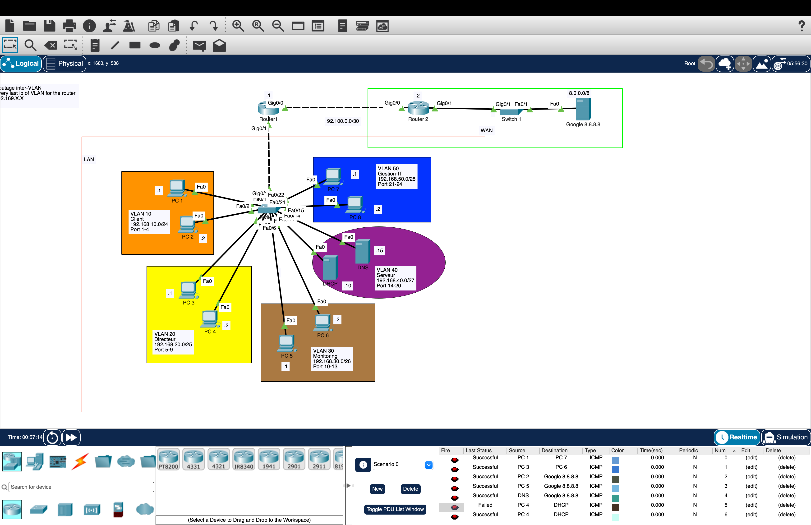
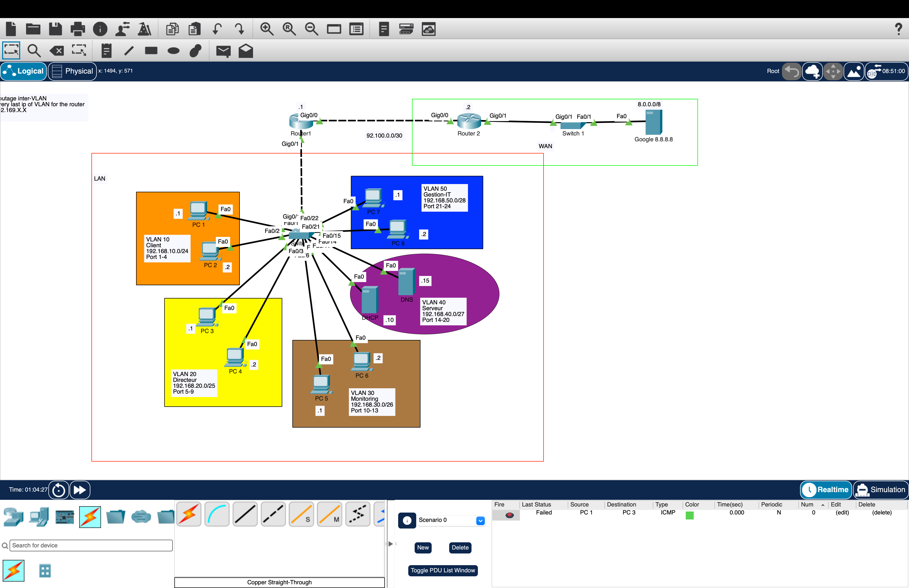
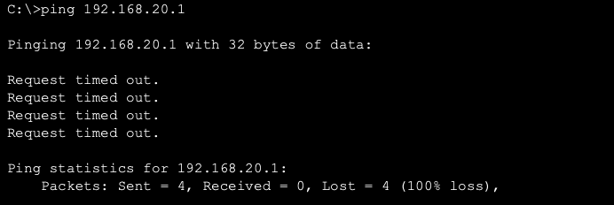
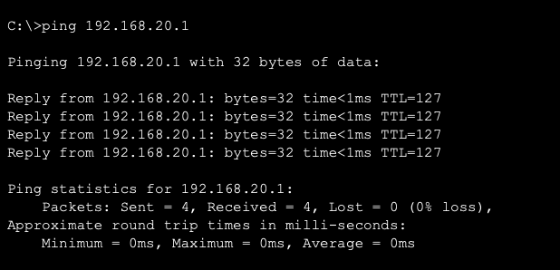
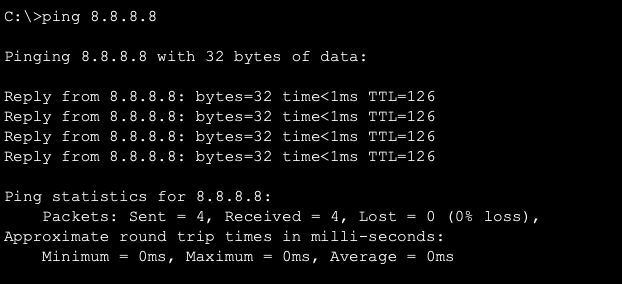

# Lab Cisco – VLAN, routage inter-VLAN, SSH et routage statique

Lab réalisé sur **Cisco Packet Tracer** dans le cadre de ma formation **Administratrice Systèmes et Réseaux (DesCodeuses)**.




---

## 🎯 Objectif

Construire un réseau d'entreprise segmenté :
- **5 VLAN** isolés par service, qui communiquent entre eux grâce au routeur (*router-on-a-stick*)
- un accès sécurisé aux équipements en **SSH**
- une sortie vers un réseau externe (serveur « Google » 8.8.8.8) par **routage statique**

**Équipements :** 2 routeurs (RT1, RT2), 2 switchs (SW0, SW1), 8 PC, 2 serveurs internes (DHCP, DNS), 1 serveur externe.

---

## 🗺️ Plan d'adressage

| VLAN | Nom | Réseau | Passerelle (RT1) | Ports SW0 | Machines |
|---|---|---|---|---|---|
| 10 | CLIENT | 192.168.10.0/24 | 192.168.10.254 | Fa0/1 – 4 | PC1, PC2 |
| 20 | DIRECTEUR | 192.168.20.0/25 | 192.168.20.126 | Fa0/5 – 9 | PC3, PC4 |
| 30 | MONITORING | 192.168.30.0/26 | 192.168.30.62 | Fa0/10 – 13 | PC5, PC6 |
| 40 | SERVEUR | 192.168.40.0/27 | 192.168.40.30 | Fa0/14 – 20 | DHCP (.10), DNS (.15) |
| 50 | GESTION_IT | 192.168.50.0/28 | 192.168.50.14 | Fa0/21 – 24 | PC7, PC8 |

| Lien | Réseau | RT1 | RT2 |
|---|---|---|---|
| WAN RT1 ↔ RT2 | 92.100.0.0/30 | 92.100.0.1 | 92.100.0.2 |
| Réseau « Google » | 8.0.0.0/8 | – | 8.255.255.254 |

> Les PC sont en adressage statique (.1 et .2 dans chaque VLAN).

---

## ⚙️ Ce qui a été configuré

**SW0 (switch)**
- Création des 5 VLAN et affectation des ports en mode *access*
- Port Gig0/1 en **trunk** (802.1Q) vers RT1
- IP de gestion sur le VLAN 40

**RT1 (routeur interne)**
- **Router-on-a-stick** : une sous-interface par VLAN sur Gig0/1 (`encapsulation dot1Q`)
- Relais DHCP (`ip helper-address`) vers le serveur du VLAN 40
- Route statique vers 8.0.0.0/8

**RT2 (routeur WAN)**
- Interfaces WAN et réseau externe
- Routes statiques **de retour** vers les 5 VLAN

**Sécurité (SW0 et RT1)**
- Bannière d'avertissement, mots de passe chiffrés (`secret`), compte local
- Console protégée par login local
- **SSH v2 uniquement** (Telnet désactivé), clés RSA 2048 bits

📁 Configurations complètes : [`v1-vlan-routage/configs/`](v1-vlan-routage/configs/)

---

## 🐞 Les pannes rencontrées (et comment je les ai trouvées)

### Panne 1 – Les VLAN ne communiquaient pas entre eux

**Symptôme :** les PC d'un même VLAN se pingaient, mais aucun ping ne passait d'un VLAN à l'autre.

**Diagnostic, couche par couche :**
1. `show ip interface brief` sur RT1 → toutes les sous-interfaces étaient *up/up* ✅
2. `show interfaces trunk` sur SW0 → trunk actif, VLAN 10 à 50 autorisés ✅
3. `show ip route` sur RT1 → les 5 réseaux bien connectés ✅
4. Ping de PC1 vers sa passerelle → OK ✅
5. `show vlan brief` sur SW0, comparé au câblage → **❌ cause trouvée**

**Cause :** j'avais branché les PC sur les ports **à la suite** (Fa0/1, Fa0/2, Fa0/3…) sans tenir compte des plages de ports de chaque VLAN. PC3 (VLAN 20) était sur **Fa0/3**, un port du **VLAN 10**. 🤦🏻‍♀️

**Correction :** rebrancher chaque PC dans la plage de ports de son VLAN (PC3 → Fa0/5, etc.).

| Avant | Après |
|---|---|
|  |  |
|  |  |

> 💡 **À retenir :** c'est le **port du switch** qui détermine le VLAN, pas le PC.

### Panne 2 – Pas d'accès à Internet (8.8.8.8)

**Symptôme :** `ping 8.8.8.8` réussissait depuis RT1, mais échouait depuis PC1.

**Diagnostic :**
- Depuis RT1, la source du ping est 92.100.0.1, un réseau que RT2 connaît directement → la réponse revient.
- Depuis PC1, la source est 192.168.10.1 → `show ip route` sur RT2 : **aucune route statique** ❌

**Cause :** les routes de retour avaient été saisies sur RT2 **sans être sauvegardées**. Elles ont été perdues au redémarrage du routeur.

**Correction :** ressaisie des 5 routes, puis `copy running-config startup-config`.

> 💡 **À retenir :** un paquet a besoin d'une route **aller** et d'une route **retour**. Et une configuration non sauvegardée n'existe pas.

---

## ✅ Vérifications

| Test | Résultat |
|---|---|
| PC1 → PC2 (même VLAN) | ✅ |
| PC1 → PC3, PC5, PC7 (inter-VLAN) | ✅ |
| PC1 → serveur DNS | ✅ |
| PC1 → 8.8.8.8 | ✅ |
| PC7 → 8.8.8.8 | ✅ |



Les PDU **Successful** en mode Simulation sont visibles sur la [capture de la topologie](v1-vlan-routage/captures/topologie.png).

---

## 🔐 Analyse sécurité

**Ce qui est en place :**
- **Segmentation** en VLAN par service : un incident dans un VLAN est plus facile à contenir.
- **Administration à distance en SSH v2** uniquement : les échanges sont chiffrés (Telnet enverrait les identifiants en clair).
- **Mots de passe stockés chiffrés** dans la configuration (`secret` plutôt que `password`).

**Limites de ce lab :**
- ⚠️ Mots de passe faibles: usage de TP uniquement. En production, il faut une politique de mots de passe robustes.
- ⚠️ **Aucun filtrage entre VLAN** : le routage inter-VLAN laisse tout passer. Un poste du VLAN **CLIENT** peut joindre le VLAN **GESTION_IT** et les serveurs. La segmentation existe, mais elle n'est pas encore une barrière.
- Le relais DHCP est configuré, mais les pools DHCP ne le sont pas : les postes sont en adressage statique.

---

## 🚀 Prochaine étape : v2 – ACL

Ajouter des **listes de contrôle d'accès (ACL)** sur RT1 pour appliquer le principe du **moindre privilège** :
- interdire au VLAN CLIENT l'accès au VLAN GESTION_IT
- limiter l'accès SSH aux équipements depuis le seul VLAN GESTION_IT
- n'autoriser vers les serveurs que les flux nécessaires (DNS, DHCP)

➡️ Dossier [`v2-acl/`](v2-acl/) – à venir.

---

## 📂 Structure du dépôt

```
lab-cisco-vlan-intervlan/
├── README.md
├── v1-vlan-routage/
│   ├── lab-vlan.pkt
│   ├── configs/        SW0.txt, RT1.txt, RT2.txt
│   └── captures/
└── v2-acl/             (à venir)
```
